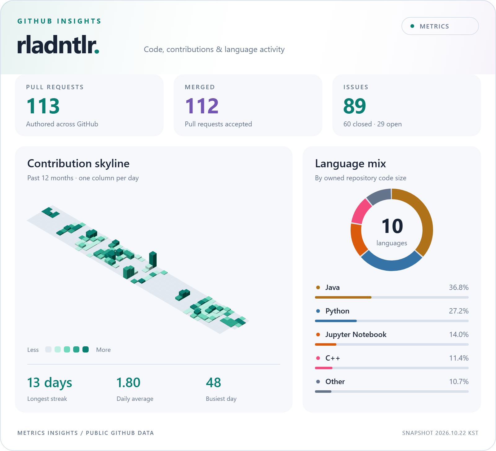
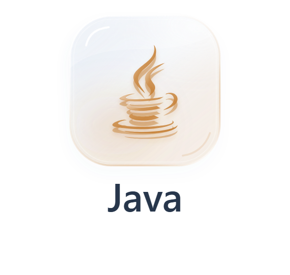
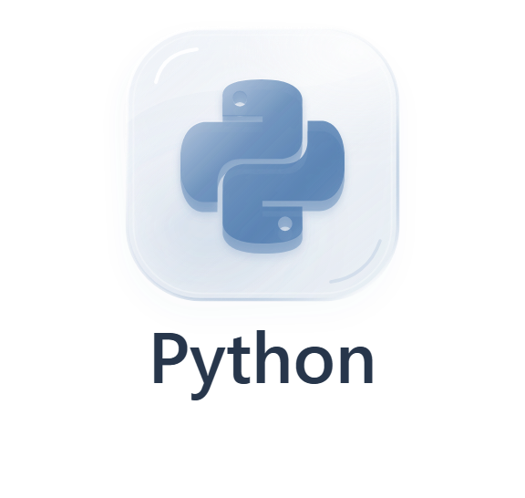
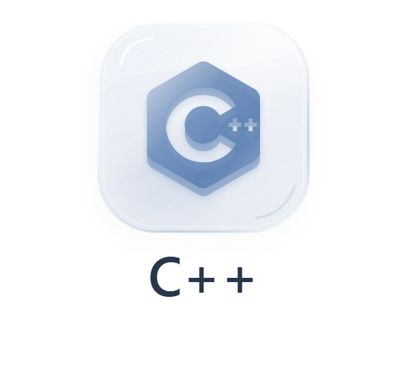
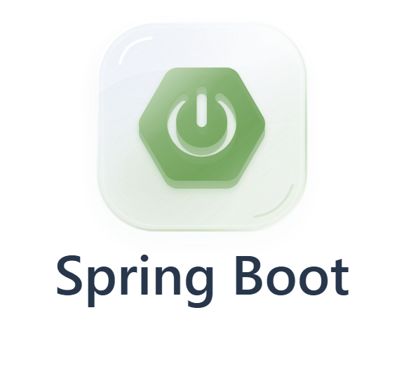
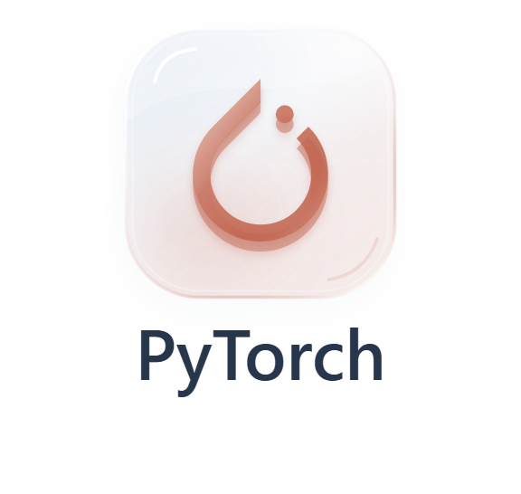
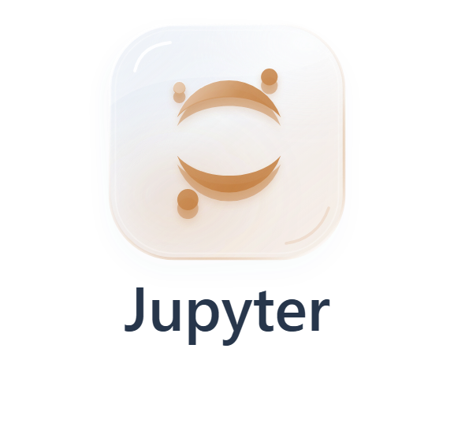
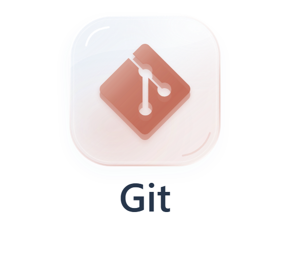
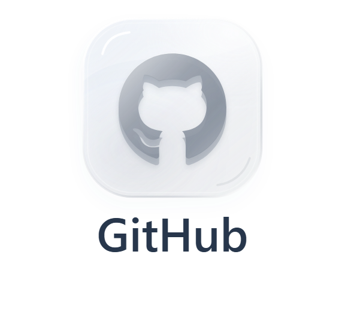

<!-- Design based on github.com/rdme0 -->
<a href="https://metrics.lecoq.io/insights?user=rladntlr">
  <picture>
    <source media="(prefers-color-scheme: dark)" srcset="assets/github-metrics-dark.png">
    
  </picture>
</a>

## 🛠️ Skills
<!-- Glass icons: scripts/render_skills.py -->

### Languages

  <picture>
    <source media="(prefers-color-scheme: dark)" srcset="assets/skills/java-glass-dark.png">
    
  </picture>
  <picture>
    <source media="(prefers-color-scheme: dark)" srcset="assets/skills/python-glass-dark.png">
    
  </picture>
  <picture>
    <source media="(prefers-color-scheme: dark)" srcset="assets/skills/cplusplus-glass-dark.png">
    
  </picture>

### Backend

  <picture>
    <source media="(prefers-color-scheme: dark)" srcset="assets/skills/springboot-glass-dark.png">
    
  </picture>
  <picture>
    <source media="(prefers-color-scheme: dark)" srcset="assets/skills/mysql-glass-dark.png">
    
  </picture>

### AI / Data

  <picture>
    <source media="(prefers-color-scheme: dark)" srcset="assets/skills/pytorch-glass-dark.png">
    
  </picture>
  <picture>
    <source media="(prefers-color-scheme: dark)" srcset="assets/skills/huggingface-glass-dark.png">
    
  </picture>
  <picture>
    <source media="(prefers-color-scheme: dark)" srcset="assets/skills/scikitlearn-glass-dark.png">
    
  </picture>
  <picture>
    <source media="(prefers-color-scheme: dark)" srcset="assets/skills/jupyter-glass-dark.png">
    
  </picture>

### Tools

  <picture>
    <source media="(prefers-color-scheme: dark)" srcset="assets/skills/git-glass-dark.png">
    
  </picture>
  <picture>
    <source media="(prefers-color-scheme: dark)" srcset="assets/skills/github-glass-dark.png">
    
  </picture>

## 💾 Projects

<!-- 집에서 채우기 -->
